# Rex BOF

`rex` provides eight Windows remote-execution primitives as native x86 and
x64 Beacon Object Files, with integrations for Cobalt Strike and Sliver.

<picture>
  <source media="(prefers-color-scheme: light)" srcset="docs/demo/demo-light.svg">
  
</picture>

## Install

Download and extract a bundle from
[Releases](https://github.com/rubyattack3r/Rex-BOF/releases):

- `Rex-BOF-<version>.zip`: Cobalt Strike CNA and all x86/x64 objects.
- `Rex-BOF-Sliver-<version>.zip`: Sliver extension manifest and the same
  x86/x64 objects.

Each bundle includes offline documentation and has a `.sha256` checksum and a
build provenance attestation:

```sh
gh attestation verify <bundle>.zip -R rubyattack3r/Rex-BOF
```

For Cobalt Strike, keep `rex.cna` and all objects together and load `rex.cna`
in Script Manager. For Sliver, install the extracted directory:

```text
extensions install /path/to/Rex-BOF-Sliver-<version>
```

## Usage

```text
# Cobalt Strike
rex help
rex preflight wmi-exec --target 10.0.0.15 --command "whoami.exe /all"
rex wmi-exec --target 10.0.0.15 --command "whoami.exe /all"

# Sliver
rex-wmi-exec --action preflight --target 10.0.0.15 --command "whoami.exe /all"
rex-wmi-exec --target 10.0.0.15 --command "whoami.exe /all"
```

One invocation operates on one target and inherits the active implant token.
Preflight validates the exact request before mutation. Rex does not accept
credentials or stage and remove payload files. A `dispatched` result proves
API acceptance, not payload completion.

See the [operator documentation](docs/index.md),
[integration guides](docs/integrations/index.md),
[technique reference](docs/techniques/index.md),
[tested platforms](docs/platforms.md), and [recovery guide](docs/recovery.md).

## Build from source

```sh
nix develop -c make verify
nix develop -c make release VERSION=v0.2.0
```

The build writes loadable files under `integrations/cna/` and
`integrations/sliver/`. The release target creates and verifies both bundles
and their checksums under `release/`.

Render the demo after editing `docs/demo/demo.toml` with:

```sh
nix develop .#demo -c make demo
```

## Responsible use

Use this tool only in environments that you own or are authorized to operate.
Follow the [Acceptable Use Policy](ACCEPTABLE_USE_POLICY.md). This guidance does
not add conditions to the MIT license.

## License

Copyright 2026 rubyattack3r. Licensed under the repository's
[MIT License](LICENSE).
