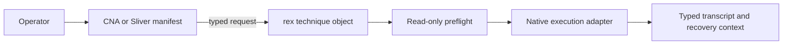

# Architecture

Rex is a native C BOF runtime. Integrations pack operator input; each object
decodes its request, runs preflight, calls the Windows API, reports the result,
and releases local resources. The Cobalt Strike CNA resolves launchers. Sliver
exposes the underlying program and argument fields.



## Source layout

- `include/rex.h` defines the shared request, result, observation, recovery, state, and technique-descriptor contracts.
- `src/common/` contains the Beacon entrypoint, registry guard, runtime helpers,
  transcript encoding, and reusable WMI and service capabilities.
- `src/techniques/` contains one implementation and linked descriptor per stable selector.
- `integrations/cna/rex.cna` maps selectors to objects, exposes named options,
  resolves launchers, and chooses x86 or x64 from the active Beacon
  architecture.
- `integrations/sliver/extension.json` exposes eight primitive commands, selects
  `amd64` or `386` objects, and uses dedicated argument-count adapters before
  entering the shared runtime.

The build emits `rex_<technique>.x86.o` and `rex_<technique>.x64.o` beside the
CNA under `integrations/cna/`, then copies the same objects beside the Sliver
manifest. Common modules are linked only into objects that declare them as
dependencies in `Makefile`.

## Build and validation

Build both architectures from the repository root:

```bash
make
```

If `boflint.py` is available, validate the generated objects with:

```bash
make verify-bof BOFLINT=/path/to/boflint.py
```

CI rejects unexpected imports, including accidental CRT and direct Win32
linkage. Test new objects on a disposable target before use; a malformed BOF
can terminate its implant process.

## Technique contract

Each object links exactly one `rex_technique` descriptor with separate decode,
preflight, execute, and release callbacks. Its canonical lowercase kebab-case
selector is shared by the native request, both integrations, and transcript
output. The Cobalt Strike entry point verifies that the selector packed by the
CNA matches the linked descriptor. The Sliver entry points derive that selector
from the descriptor and accept only the one, two, or three technique values
declared by the manifest.

Preflight finishes before execution begins. Release runs after preflight-only,
success, and failure paths and must handle partial initialization. Record
recovery data as soon as a reversible remote change is made.

## Adding a technique

Add the implementation and descriptor under `src/techniques/`, declare its
common-source dependencies in `Makefile`, and map the stable selector and
named options in both `integrations/cna/rex.cna` and
`integrations/sliver/extension.json`. Keep technique-specific native API
details out of integrations. Add the matching technique page, preflight
evidence, recovery contract, detection considerations, and x86/x64 validation
together.

