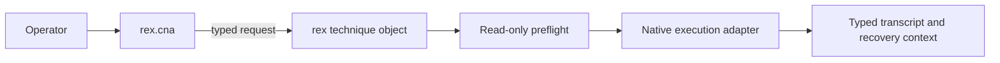

# Architecture

`rex` is a native C BOF runtime, not a Go CLI compiled as COFF. The CNA owns operator-facing parsing and launcher resolution; the object files own typed decoding, read-only preflight, native API execution, result construction, and process-local resource release.



## Source layout

- `include/rex.h` defines the shared request, result, observation, recovery, state, and technique-descriptor contracts.
- `src/common/` contains the Beacon entrypoint, registry guard, runtime helpers, transcript encoding, and reusable WMI and service capabilities.
- `src/techniques/` contains one implementation and linked descriptor per stable selector.
- `integrations/cna/rex.cna` maps selectors to objects, exposes named options, resolves launchers, and chooses x86 or x64 from the active Beacon architecture.

The build emits `rex_<technique>.x86.o` and `rex_<technique>.x64.o` beside the CNA under `integrations/cna/`. Common modules are linked only into objects that declare them as dependencies in `Makefile`.

## Build and validation

Build both architectures from the repository root:

```bash
make
```

If `boflint.py` is available, validate the generated objects with:

```bash
make verify-bof BOFLINT=/path/to/boflint.py
```

CI also rejects unexpected imports so accidental CRT or direct Win32 linkage cannot enter an object unnoticed. A malformed BOF can terminate the containing implant; validate new objects against a disposable authorized target before operational use.

## Technique contract

Each object links exactly one `rex_technique` descriptor with separate decode, preflight, execute, and release callbacks. The common entrypoint verifies that the selector packed by the CNA matches the linked descriptor, preventing an object-selector mismatch.

Preflight must finish before the execute callback runs. Release must tolerate partial initialization and run after preflight-only, successful execution, and failure paths. Recovery context must be populated as soon as reversible remote state exists so an execution failure does not discard it.

## Adding a technique

Add the implementation and descriptor under `src/techniques/`, declare its common-source dependencies in `Makefile`, and map the stable selector to its object basename and named options in `integrations/cna/rex.cna`. Keep technique-specific native API details out of the CNA. Add the matching technique page, preflight evidence, recovery contract, detection considerations, and x86/x64 validation together.

