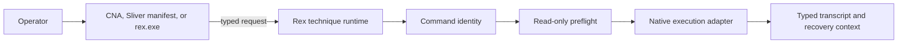

# Architecture

Rex is a native C remote-execution runtime. Cobalt Strike and Sliver pack
operator input for individual BOFs; the standalone CLI calls the same shared
technique registry directly. Every surface decodes a request, establishes the
selected command identity, runs preflight, calls the Windows API, releases
local resources, and then reports the result. The Cobalt Strike CNA resolves
launchers. Sliver and the standalone CLI expose primitive fields.



## Source layout

- `include/rex.h` defines the shared request, result, observation, recovery, state, and technique-descriptor contracts.
- `src/common/` contains the Beacon entrypoint, registry guard, lifecycle and
  command-identity handlers, runtime helpers, transcript encoding, COM security
  setup, and reusable WMI and service capabilities.
- `src/techniques/` contains one implementation and descriptor loader per
  stable selector.
- `integrations/cna/rex.cna` maps selectors to objects, exposes named options,
  resolves launchers, and chooses x86 or x64 from the active Beacon
  architecture.
- `integrations/sliver/extension.json` exposes twelve primitive commands, selects
  `amd64` or `386` objects, and uses dedicated argument-count adapters before
  entering the shared runtime.
- `src/standalone/` provides the Windows CLI entrypoint, console output adapter,
  and direct-import mapping used to link all released techniques into one PE.

The build uses Zig to compile one translation unit per technique and
architecture. `src/technique_unit.c` includes the shared runtime, the common
capabilities selected by `Makefile`, and one technique implementation. The
resulting `rex_<technique>.x86.o` and `rex_<technique>.x64.o` files are written
beside the CNA under `integrations/cna/`, then copied beside the Sliver
manifest. `clang-format` owns C source formatting and preserves the deliberate
Windows and COM header order.

The standalone build links all technique descriptor loaders into
`rex.x64.exe` and `rex.x86.exe`. Its Windows and C runtime imports are ordinary
PE imports; the BOFs retain their no-CRT, `MODULE$function` import contract.

The x64 objects contain no `IMAGE_REL_AMD64_ADDR64` or `.refptr`
relocations. Technique descriptor loaders populate caller-owned storage at
runtime, and the build disables jump tables that would otherwise place
absolute pointers in `.rdata`. `make verify` checks this Cobalt Strike loader
constraint for every stable object.

## Build and validation

Build both architectures from the repository root:

```bash
make
```

If `boflint.py` is available, validate the generated objects with:

```bash
make verify-bof BOFLINT=/path/to/boflint.py
```

CI rejects unsupported x64 relocations and unexpected imports, including
accidental CRT and direct Win32 linkage. Test new objects on a disposable
target before use; a malformed BOF can terminate its implant process.

## Technique contract

Each object has exactly one `rex_technique` descriptor loader with separate
decode, preflight, execute, and release callbacks. The loader fills a local
descriptor without a global function-pointer table. Its canonical lowercase
kebab-case selector is shared by the native request, both integrations, and
transcript output. The Cobalt Strike entry point verifies that the selector
packed by the CNA matches the object descriptor. The Sliver entry points
derive that selector from the descriptor and accept only the one, two, or
three technique values declared by the manifest.

Preflight finishes before execution begins. Release runs after preflight-only,
success, and failure paths and must handle partial initialization. Record
recovery data as soon as a reversible remote change is made.

The shared runtime enforces `new -> decoded -> preflighting -> ready ->
executing -> executed -> releasing -> released`. Failure paths transition
directly to release. Technique code owns its private native state, but it does
not choose or skip lifecycle transitions.

The identity handler wraps that lifecycle. With no credential options, the
runtime stays on the caller's current thread and identity. With make-token
options, the caller creates a `LOGON32_LOGON_NEW_CREDENTIALS` token so its
current local identity is cloned. A joined worker impersonates that token, runs
the entire lifecycle, and reverts. The caller then closes the token. Output is
deferred until after the worker exits, so no C2 callbacks run from the worker
and no command changes the caller's token state.

## Adding a technique

Add the implementation and `REX_DEFINE_TECHNIQUE` descriptor loader under
`src/techniques/`, declare its common-source dependencies in `Makefile`, and
map the stable selector and named options in both
`integrations/cna/rex.cna` and
`integrations/sliver/extension.json`. Keep technique-specific native API
details out of integrations. Add the matching technique page, preflight
evidence, recovery contract, detection considerations, and x86/x64 validation
together.

