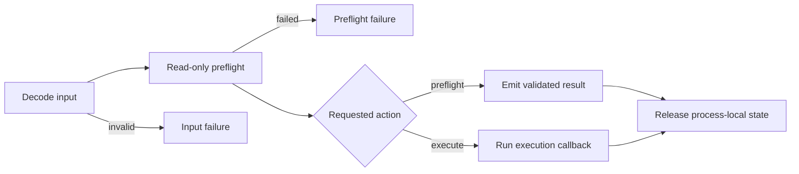

# BOF preflight

Preflight checks a technique's remote requirements without making its
persistent change. Execution starts only after preflight succeeds.



Preflight still authenticates and connects to remote APIs, so it can generate
network and audit events.

## Check-only command

Prefix the ordinary technique invocation with `preflight` and retain the same
options:

```text
rex preflight wmi-exec --target 10.0.0.15 --command "whoami.exe /all"
rex preflight scm-change-service --target 10.0.0.15 \
  --service-name ExistingService \
  --remote-path C:\ProgramData\service.exe
```

After the check succeeds, Rex reports `validated` and skips execution:

```text
technique=wmi-exec target=10.0.0.15 status=succeeded disposition=validated source=wmi_cimv2_session
```

A normal `rex <technique> ...` command runs the same check before execution.

| Technique | Evidence source | Read-only checks before execution |
| --- | --- | --- |
| `wmi-exec` | `wmi_cimv2_session` | Opens an authenticated WMI session to `root\cimv2`. |
| `wmi-service` | `service_snapshot_and_wmi_session` | Reads the service path and start type, confirms it is stopped, and opens WMI. |
| `scm-change-service` | `scm_service_snapshot` | Opens the service, reads its path and start type, and confirms it is stopped. |
| `scm-create-service` | `scm_service_name_available` | Opens SCM with create rights and confirms the service name is unused. |
| `task-sched-exec` | `task_scheduler_name_available` | Connects to the Task Scheduler root folder and confirms the task name is unused. |
| `wsman-exec` | `wsman_shell` | Validates the transport, creates a WSMan session, and opens a temporary shell. |
| `dcom-ishell-dispatch2` | `ishelldispatch2_interface` | Activates the Shell COM class and resolves `IShellDispatch2` from an interactive Explorer session. |
| `wmi-provider` | `wmi_provider_and_registry_available` | Opens WMI, confirms the provider and COM registration are unused, and opens the registry view matching the BOF architecture. |

## What preflight does not check

Preflight does not verify:

- that a referenced remote executable or DLL exists;
- payload hashes, free space, or SMB delivery;
- native exports, managed metadata, or CPL entry points;
- launcher and target-process architecture compatibility;
- payload behavior or completion; or
- credentials other than the active implant token.

Place the artifact on the target, choose the matching BOF architecture, set the
required token context, and select the correct [launcher](launchers/index.md)
before execution.

## Failure and release behavior

Input and preflight failures occur before the technique changes persistent
remote state. Rex still releases handles, interfaces, sessions, and allocations
opened during the check.

Execution may fail after a remote change. When possible, the failure includes
the values needed for cleanup. For example, a failed service start still
reports a preceding binary-path change.

See the [technique reference](techniques/index.md), [transcript output](output.md),
and [cleanup guide](recovery.md).
