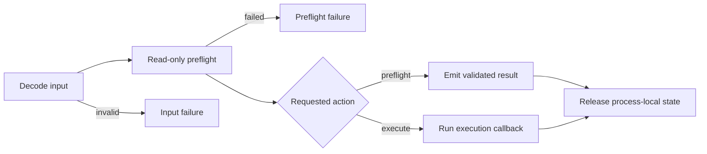

# BOF preflight

Every technique object separates argument decoding, read-only preflight, remote
execution, and local resource release. Here, read-only means no persistent
technique-owned target change. The shared entrypoint does not call a technique's
`execute` callback unless its `preflight` callback succeeds.



Preflight is deliberately technique-scoped. It proves the remote API state the
BOF can inspect without making a persistent technique-owned change; it is not a
delivery or payload-validation pipeline. It is not invisible: authentication,
RPC/DCOM activation, WMI connections, and the transient WSMan shell can still
produce network, process, and audit telemetry.

## Check-only command

Prefix the ordinary technique invocation with `preflight` and retain the same
options:

```text
rex preflight wmi-exec --target 10.0.0.15 --command "whoami.exe /all"
rex preflight scm-change-service --target 10.0.0.15 \
  --service-name ExistingService \
  --remote-path C:\ProgramData\service.exe
```

The CNA packs a typed `preflight` action into the BOF request. After decode and
preflight succeed, the shared entrypoint emits a result and releases the
technique state without calling `execute`:

```text
technique=WMIExec target=10.0.0.15 status=succeeded disposition=validated source=wmi_cimv2_session
```

Normal `rex <technique> ...` invocations pack the `execute` action and continue
from the same successful preflight into execution.

| Technique | Evidence source | Read-only checks before execution |
| --- | --- | --- |
| `WMIExec` | `wmi_cimv2_session` | Opens an authenticated WMI session to `root\cimv2`. |
| `WMIService` | `service_snapshot_and_wmi_session` | Opens the named service, captures its binary path and start type, proves it is stopped, and opens WMI. |
| `SCMChangeService` | `scm_service_snapshot` | Opens the named service with the required rights, captures its binary path and start type, and proves it is stopped. |
| `SCMCreateService` | `scm_service_name_available` | Opens SCM with create rights and proves the requested service name is unused. |
| `TaskSchedExec` | `task_scheduler_name_available` | Connects to the remote Task Scheduler root folder and proves the requested task name is unused. |
| `WSManExec` | `wsman_shell` | Validates the transport value, creates a WSMan session, and opens a transient remote shell. |
| `DCOMIShellDispatch2` | `ishelldispatch2_interface` | Activates the remote Shell COM class and resolves a usable `IShellDispatch2` interface from an interactive Explorer session. |
| `WMIProvider` | `wmi_provider_and_registry_available` | Opens `root\default` and `root\cimv2`, proves the provider name and COM registration are unused, and opens the remote registry view matching the BOF architecture. |

## What preflight does not prove

The BOF never reads a local payload, stages a file, or authenticates with an
operator-supplied credential. It therefore does not verify:

- that a referenced remote executable or DLL exists;
- payload hashes, free space, or SMB delivery;
- native exports, managed metadata, or CPL entry points;
- launcher and target-process architecture compatibility;
- payload-defined side effects or whether a dispatched process completed; or
- an identity other than the active Beacon token.

Those are operator-owned checks. Stage the exact artifact first, select an
architecture-compatible object, establish the intended token context, and use
the [launcher contract](launchers/index.md) that matches the payload.

## Failure and release behavior

An input or preflight failure occurs before a technique-owned persistent
mutation. The BOF still releases any COM interfaces, WMI/WSMan sessions, service
handles, registry handles, and heap allocations acquired while checking the
target.

Execution can fail after a mutation. In that case the result phase is
`execution`, and the observation includes recovery context as soon as the
reversible state exists. For example, a service start failure after a successful
binary-path change still reports the service name, original path, applied path,
original start type, and original stopped state.

See the [technique reference](techniques/index.md) for each mutation, [transcript output](output.md) for the result contract, and [operator recovery](recovery.md) for retained remote state.
