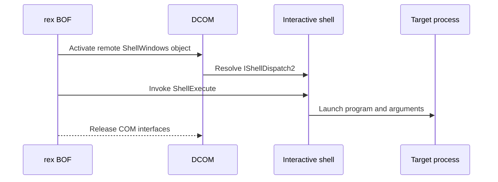

# DCOMIShellDispatch2

## Mechanism and prerequisites

Activates the remote Shell COM class, resolves `IShellDispatch2` from a usable interactive Explorer session, and invokes `ShellExecute`. It accepts a program with optional arguments or a CNA-resolved [launcher contract](../launchers/index.md). It requires local-administrator rights, reachable DCOM, and an active interactive user shell on the target.

Finding an `explorer.exe` process is not sufficient. Preflight must resolve the Shell automation interface in a usable session before execution.

## Privilege and network surface

- Local administrator on the target
- Active interactive user logon with a usable Explorer shell
- DCOM via TCP 135 and negotiated dynamic RPC ports
- No BOF-managed SMB delivery; referenced files must already exist remotely

## Operator recovery

The technique releases its COM interfaces and creates no generic persistent configuration record. Remove separately delivered files after the launched process releases them. Program-defined side effects remain operator-owned. See [operator recovery](../recovery.md).

## Detection considerations

Visibility depends on DCOM activation telemetry, but `ShellExecute` and the resulting process remain detectable. The active-shell precondition narrows usable targets; it does not make the technique quiet or undetectable.

