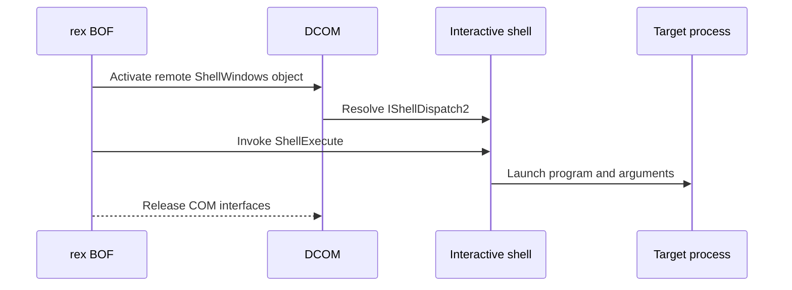

# dcom-ishell-dispatch2

## How it works

Rex activates the remote Shell COM class, gets `IShellDispatch2` from an
interactive Explorer session, and calls `ShellExecute`. Cobalt Strike can
supply the program through a [launcher contract](../launchers/index.md).

An `explorer.exe` process alone is not enough. Preflight must resolve the Shell
automation interface in a usable session.

## Requirements

- Local administrator on the target
- Active interactive user logon with a usable Explorer shell
- DCOM via TCP 135 and negotiated dynamic RPC ports
- Referenced files already present on the target

## Cleanup

Delete payload files after the launched process releases them, and clean up
changes made by the program. See [recovery](../recovery.md).

## Detection

Relevant telemetry includes DCOM activation, `ShellExecute`, and the resulting
process.

