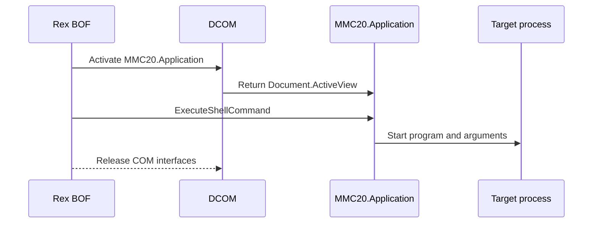

# dcom-mmc20

> This candidate is not included in release bundles. On Windows Server 2025
> build 26100, native and PowerShell controls succeeded, but Sliver v1.7.9
> blocked in `IDispatch::Invoke` and produced no payload marker.

## How it works

Rex activates `MMC20.Application` on the target, resolves the active MMC view,
and calls `ExecuteShellCommand`. A supported implementation would return after
starting the program.

The candidate uses a cancellable worker and joins it before the BOF can be
unloaded. A timed-out call returns `0x800705b4` instead of leaving code running
on a detached thread. Cancellation can leave a remote `mmc.exe`; it does not
turn a failed execution into success.

## Requirements

- Local administrator on the target
- DCOM via TCP 135 and negotiated dynamic RPC ports
- `MMC20.Application` registered on the target
- Referenced files already present on the target

## Cleanup

Delete payload files after the process releases them, and clean up changes made
by the program. See [recovery](../recovery.md).

## Detection

Relevant telemetry includes remote MMC activation, `mmc.exe` process ancestry,
the `ExecuteShellCommand` call, and the resulting process.
