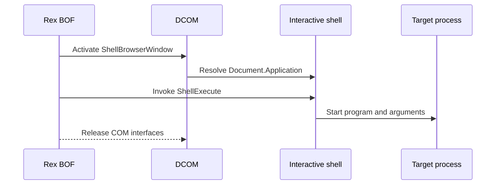

# dcom-shell-browser-window

> This candidate is not included in release bundles. Windows Server 2025
> build 26100 rejected remote activation under both SYSTEM and an active
> interactive administrator token.

## How it works

Rex activates the `ShellBrowserWindow` class on the target, resolves its
document's Shell application object, and calls `ShellExecute`. This path uses
the target's interactive Explorer shell.

Windows Server 2025 build 26100 returned `0x80004005` during remote class
activation from both SYSTEM and the active interactive administrator. Treat
this selector as platform-dependent and unvalidated until the exact target
environment passes preflight. See [tested environments](../platforms.md).

## Requirements

- Local administrator on the target
- Active interactive user logon with a usable Explorer shell
- An implant identity and session from which remote `ShellBrowserWindow`
  activation succeeds; an `explorer.exe` process alone is not sufficient
- DCOM via TCP 135 and negotiated dynamic RPC ports
- Referenced files already present on the target

## Cleanup

Delete payload files after the process releases them, and clean up changes made
by the program. See [recovery](../recovery.md).

## Detection

Relevant telemetry includes `ShellBrowserWindow` activation, `ShellExecute`,
and the resulting process in the interactive user's session.
