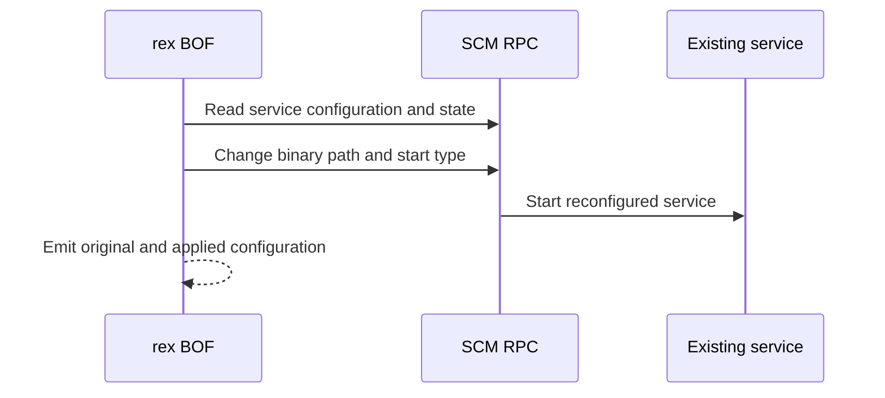

# SCMChangeService

## Mechanism and prerequisites

Uses Service Control Manager RPC to snapshot and reconfigure an existing stopped service so it launches an already-staged service executable. It requires local-administrator rights, reachable SCM RPC, an explicitly selected service, and readable original configuration. Preflight captures the original binary path and start type and proves the service is stopped before modification.

Payload support: a Windows service executable that already exists on the target and implements the lifecycle expected by the selected service.

## Privilege and network surface

- Local administrator on the target
- SCM RPC, commonly over SMB on TCP 445
- RPC endpoint mapper on TCP 135 where required
- No BOF-managed file delivery; the service executable must already exist remotely

## Operator recovery

Stop the service if safe, compare its current configuration with the emitted recovery context, and restore the original binary path and start type. The preflight-proven original state is stopped. Remove the separately delivered executable only after the service releases it. See [operator recovery](../recovery.md).

## Detection considerations

SCM configuration changes, service starts, and anomalous image paths are well-signatured. Selecting a service that is already noisy can change baseline rarity, but does not make the technique undetectable.

