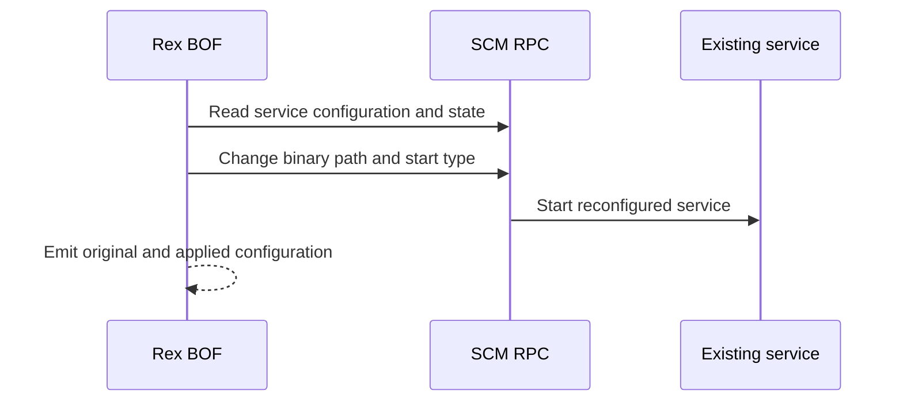

# scm-change-service

## How it works

Rex uses Service Control Manager RPC to read and reconfigure an existing stopped
service. Preflight records its binary path and start type and confirms that it
is stopped.

The replacement executable must already be on the target and implement the
Windows service lifecycle.

## Requirements

- Local administrator on the target
- SCM RPC, commonly over SMB on TCP 445
- RPC endpoint mapper on TCP 135 where required
- Service executable already present on the target

## Cleanup

Stop the service, confirm its current configuration, and restore the recorded
binary path and start type. Delete the executable after the service releases
it. See [recovery](../recovery.md).

## Detection

Relevant telemetry includes SCM configuration changes, service starts, and
image paths.

