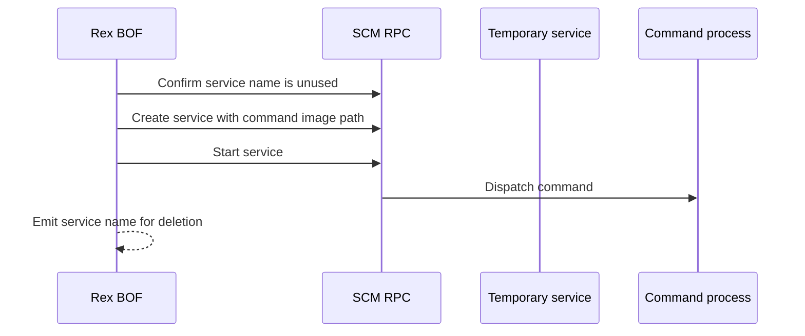

# scm-command

## How it works

Rex creates a demand-start service whose image path is the supplied command
line, then asks SCM to start it. A command process does not connect to the
service control dispatcher, so Rex treats SCM's expected service timeout as a
successful dispatch. It does not upload a binary or capture command output.

## Identity

The current or make-token identity authenticates the SCM operations. Rex
creates the command-backed service under `LocalSystem`, so the command does not
run as the make-token account. See the [identity matrix](../identity.md).

## Requirements

- Local administrator on the target
- SCM RPC over SMB on TCP 445
- RPC endpoint mapper on TCP 135 where required
- A complete Windows command line

## Cleanup

Delete the reported service and verify that it is gone. The recovery record
does not repeat the command line. Clean up any state created by the command.
See [recovery](../recovery.md).

## Detection

The service configuration records the full command line. Relevant telemetry
includes service creation and start events, SCM RPC, and the resulting process.
