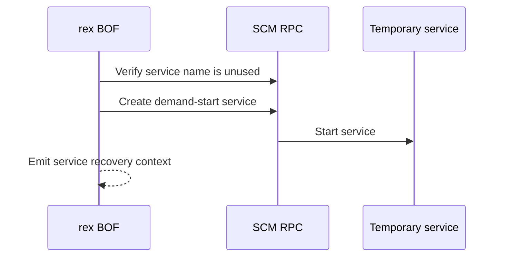

# scm-create-service

## How it works

Rex creates and starts a service through SCM RPC. It implements the familiar
PsExec-style service pattern without using the PsExec utility.

## Requirements

- Local administrator on the target
- SCM RPC over SMB on TCP 445
- RPC endpoint mapper on TCP 135 where required
- Service executable already present on the target

## Cleanup

Stop and delete the reported service, then verify that it is gone. Delete the
executable after the service releases it. See [recovery](../recovery.md).

## Detection

Relevant telemetry includes service creation, service start activity, the
service image path, and the separate file-transfer method.

