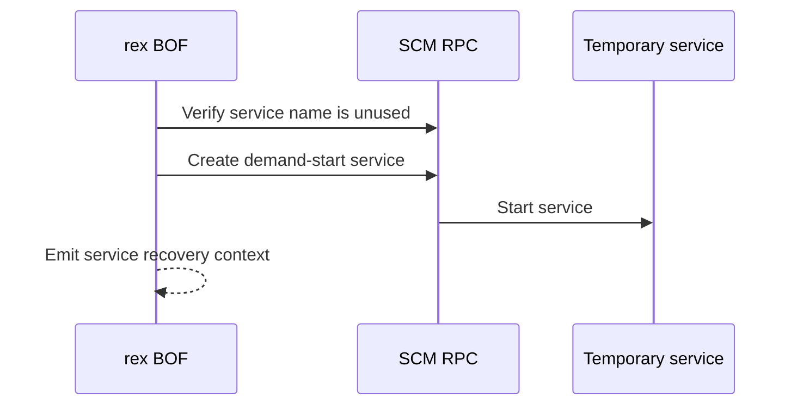

# SCMCreateService

## Mechanism and prerequisites

Implements a PsExec-style primitive natively by creating and starting a temporary service through SCM RPC. It requires local-administrator rights, reachable SCM RPC, an unused service name, and a Windows service executable that already exists on the target. It does not bundle or invoke Microsoft's PsExec utility.

## Privilege and network surface

- Local administrator on the target
- SCM RPC over SMB on TCP 445
- RPC endpoint mapper on TCP 135 where required
- No BOF-managed file delivery; the service executable must already exist remotely

## Operator recovery

Stop the exact reported service if it is still running, delete it, and verify its absence. Remove the separately delivered executable only after the service releases it. See [operator recovery](../recovery.md).

## Detection considerations

New-service installation, service start activity, and a retained service definition are well-signatured PsExec-style lateral-movement indicators. File-delivery telemetry depends on the separate mechanism used to place the executable. Custom naming does not make the technique undetectable.

