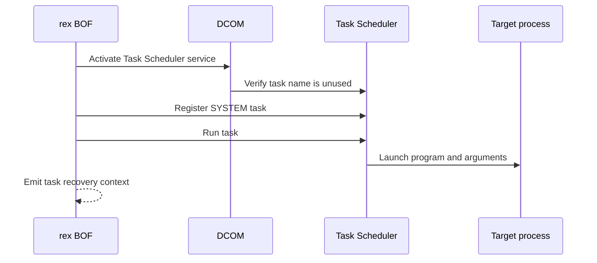

# TaskSchedExec

## Mechanism and prerequisites

Uses DCOM to connect to Task Scheduler, registers a SYSTEM task in the root folder, and starts it. It accepts a program with optional arguments or a CNA-resolved [launcher contract](../launchers/index.md). It requires local-administrator rights, reachable DCOM/RPC, a functioning Task Scheduler service, and an unused task name.

## Privilege and network surface

- Local administrator on the target
- DCOM via TCP 135 and negotiated dynamic RPC ports
- No BOF-managed SMB delivery; referenced files must already exist remotely

## Operator recovery

Delete the exact task name reported in the recovery line after collecting the required evidence. Remove any separately delivered payload only after the task and launched process release it. See [operator recovery](../recovery.md).

## Detection considerations

Task registration and execution events, a retained task definition, RPC activity, and process creation are well-signatured. Custom task naming changes telemetry details, not the underlying observability.

