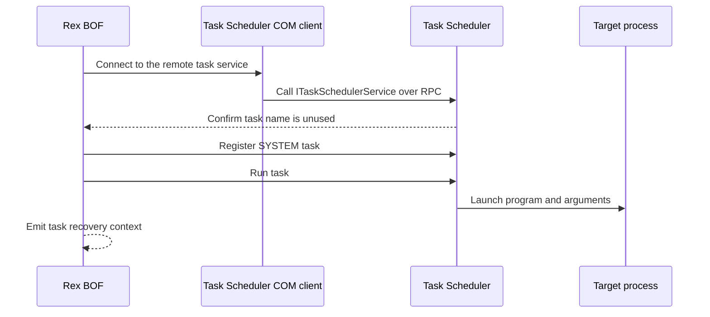

# task-sched-exec

## How it works

Rex uses the Task Scheduler COM client, which connects to the remote
`ITaskSchedulerService` RPC interface. It registers a SYSTEM task in the root
folder and starts it. Cobalt Strike can supply the program through a
[launcher contract](../launchers/README.md).

## Requirements

- Local administrator on the target
- DCOM via TCP 135 and negotiated dynamic RPC ports
- Referenced files already present on the target

## Cleanup

Delete the reported task. Delete the payload after the task and its process
release it. See [recovery](../recovery.md).

## Detection

Relevant telemetry includes task registration, task execution, RPC activity,
and process creation.

