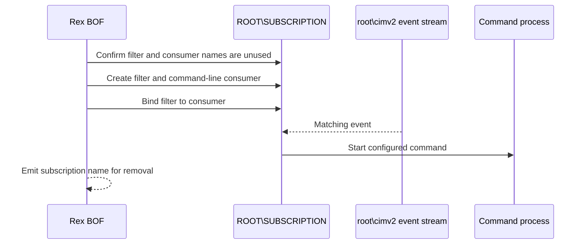

# wmi-event-subscription

## How it works

Rex creates a named `__EventFilter`, `CommandLineEventConsumer`, and
`__FilterToConsumerBinding` in `ROOT\SUBSCRIPTION`. The WQL query runs against
`root\cimv2`; every matching event starts the supplied command until the
subscription is removed.

## Command contract

`--command` is stored unchanged as `CommandLineTemplate`; Rex does not insert a
shell or resolve a launcher. Supply a complete target-side Windows command
line. It runs in the standard consumer's local-system context whenever the WQL
query matches.

See the complete [WMI event-consumer command contract](../contracts/wmi-event-command.md)
for quoting, execution context, query validation, repetition, and result
boundaries.

## Requirements

- Local administrator on the target
- WMI/DCOM via TCP 135 and negotiated dynamic RPC ports
- A valid WQL event query for `root\cimv2`
- A complete Windows command line satisfying the event-consumer contract

## Cleanup

Remove the binding first, then the command-line consumer and event filter with
the reported name. If execution fails after creating one of these objects, the
failure transcript still includes the same recovery record. See
[recovery](../recovery.md).

## Detection

Relevant telemetry includes permanent WMI consumer creation, changes in
`ROOT\SUBSCRIPTION`, WMI Activity logs, and processes started by
`WmiPrvSE.exe` when the query matches.
