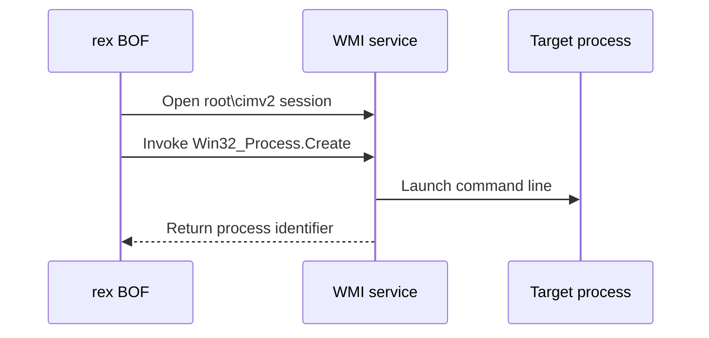

# WMIExec

## Mechanism and prerequisites

Calls `Win32_Process.Create` through WMI. It accepts one complete command line or a CNA-resolved [launcher contract](../launchers/index.md). It requires local-administrator rights and reachable WMI/DCOM. Any referenced executable or payload must already exist on the target.

## Privilege and network surface

- Local administrator on the target
- WMI/DCOM via TCP 135 and negotiated dynamic RPC ports
- No BOF-managed SMB delivery; referenced files must already exist remotely

## Operator recovery

The technique creates no generic persistent configuration record. The returned PID identifies the process created by `Win32_Process.Create`; it does not prove payload completion. Command-defined side effects and separately delivered files remain operator-owned. See [operator recovery](../recovery.md).

## Detection considerations

Remote WMI process creation is well-signatured. A direct command avoids launcher-specific module-load signals, but the WMI invocation and resulting process command line remain detectable.

