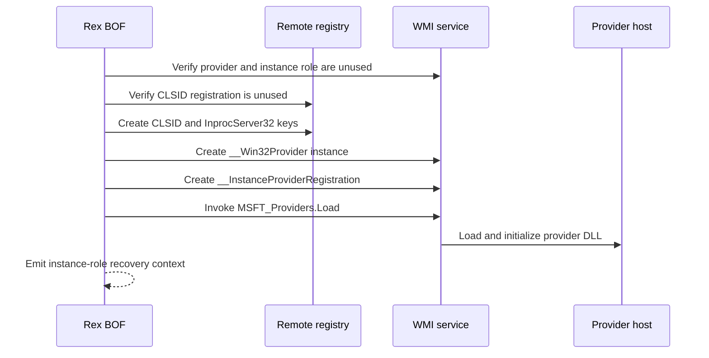

# wmi-instance-provider

## How it works

Rex registers the DLL as a COM server, creates a `__Win32Provider` instance
and an `__InstanceProviderRegistration` in `root\default`, then calls
`MSFT_Providers.Load`. The instance role advertises retrieval and enumeration;
put and delete operations remain disabled.

The provider DLL and compatible managed-class schema must already be on the
target. Rex does not install MOF or create, replace, or modify a managed class.

## Provider contract

The DLL must satisfy the shared
[WMI provider DLL contract](../contracts/wmi-provider.md), implement the
instance-provider operations it advertises through `IWbemServices`, and match
the BOF architecture. A class served by the provider must already exist in
`root\default` with compatible `Dynamic` and `Provider` qualifiers.

## Identity

The current or make-token identity performs the remote WMI and registry
operations. The provider callbacks run in the `LocalSystem` WMI provider host,
not as the make-token account. See the [identity matrix](../identity.md).

## Requirements

- Local administrator on the target
- WMI/DCOM via TCP 135 and negotiated dynamic RPC ports
- Remote registry access through the selected command identity
- Contract-compliant instance-provider DLL at an absolute target-local path
- Compatible managed-class schema already registered in `root\default`

## Cleanup

Call `MSFT_Providers.UnLoad`, delete the provider's
`__InstanceProviderRegistration`, delete its `__Win32Provider` instance, and
remove its `InprocServer32` and CLSID keys. Remove any separately installed
managed-class schema only when it belongs to the same operation. Delete the
DLL after the provider host releases it. See [recovery](../recovery.md).

## Detection

Relevant telemetry includes instance-provider and COM registration, registry
changes, WMI activity, provider-host DLL loads, and subsequent queries against
classes associated with the provider.
