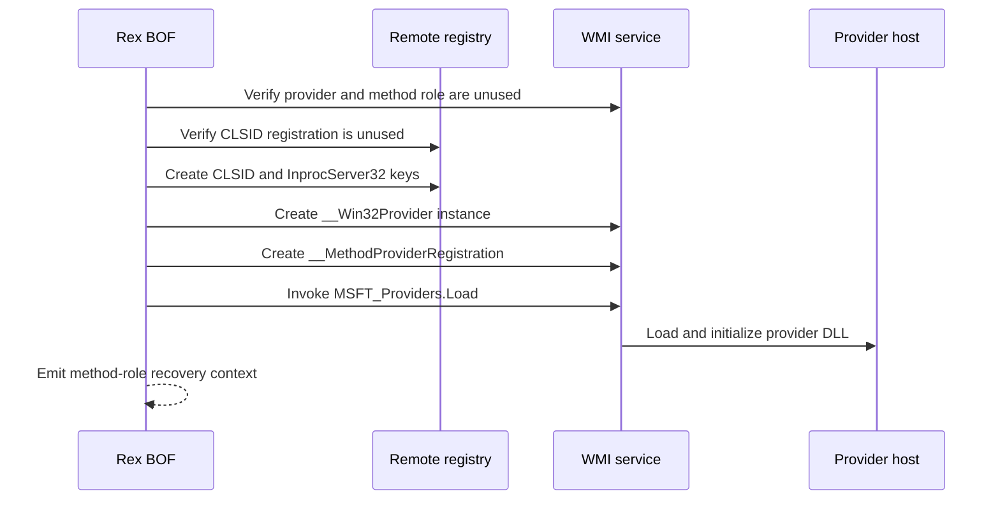

# wmi-method-provider

## How it works

Rex registers the DLL as a COM server, creates a `__Win32Provider` instance
and a `__MethodProviderRegistration` in `root\default`, then calls
`MSFT_Providers.Load`.

The provider DLL and compatible managed-class schema must already be on the
target. Rex loads and registers the provider role; it does not invoke a
managed-class method, install MOF, or create, replace, or modify a class.

## Provider contract

The DLL must satisfy the shared
[WMI provider DLL contract](../contracts/wmi-provider.md), implement method
dispatch through `IWbemServices`, and match the BOF architecture. A class
served by the provider must already exist in `root\default` with compatible
`Dynamic` and `Provider` qualifiers; its implemented methods must be declared
in that schema.

## Requirements

- Local administrator on the target
- WMI/DCOM via TCP 135 and negotiated dynamic RPC ports
- Remote registry access through the selected command identity
- Contract-compliant method-provider DLL at an absolute target-local path
- Compatible managed-class schema already registered in `root\default`

## Cleanup

Call `MSFT_Providers.UnLoad`, delete the provider's
`__MethodProviderRegistration`, delete its `__Win32Provider` instance, and
remove its `InprocServer32` and CLSID keys. Remove any separately installed
managed-class schema only when it belongs to the same operation. Delete the
DLL after the provider host releases it. See [recovery](../recovery.md).

## Detection

Relevant telemetry includes method-provider and COM registration, registry
changes, WMI activity, provider-host DLL loads, and subsequent method calls
against classes associated with the provider.
