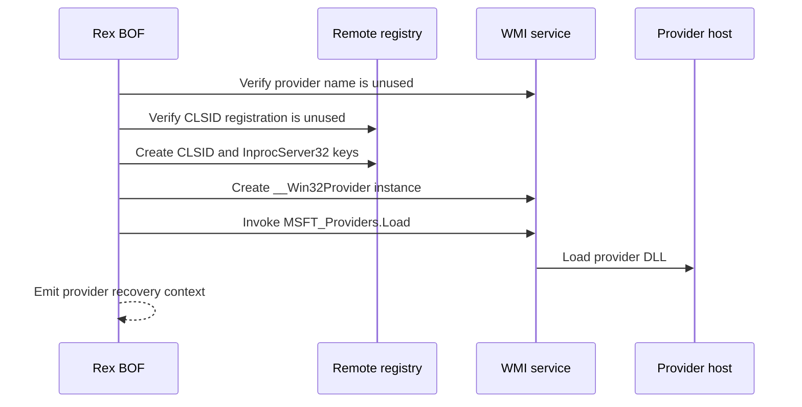

# wmi-provider

## How it works

Rex registers COM metadata and a `__Win32Provider` instance, then calls
`MSFT_Providers.Load`. The provider DLL must already be on the target, match the
BOF architecture, and implement the COM class identified by
`--provider-clsid`.

This selector is the initialization-only provider role. It does not create an
instance, method, property, or event-provider registration. Use
[`wmi-instance-provider`](wmiinstanceprovider.md) or
[`wmi-method-provider`](wmimethodprovider.md) when the target-side schema and
DLL implement one of those roles.

The provider host loads the DLL directly; this technique does not use a
launcher.

## Provider DLL contract

The DLL must be an architecture-matched in-process COM server whose
`DllGetClassObject` returns a class factory for the supplied CLSID. The created
object must implement `IWbemProviderInit`, report initialization through its
status sink, support `ThreadingModel=Both`, and unload cleanly. Rex performs
the COM registration, so self-registration exports are not required.

See the complete [WMI provider DLL contract](../contracts/wmi-provider.md),
including exports, interfaces, hosting, role-specific interfaces, schema, and
validation.

## Requirements

- Local administrator on the target
- WMI/DCOM via TCP 135 and negotiated dynamic RPC ports
- Remote registry access through the WMI and registry interfaces used by the selected command identity
- Contract-compliant provider DLL already present at an absolute target-local
  path

## Cleanup

Call `MSFT_Providers.UnLoad`, delete the reported `__Win32Provider` instance,
and remove its `InprocServer32` and CLSID keys. Delete the DLL after the
provider host releases it. See [recovery](../recovery.md).

## Detection

Relevant telemetry includes provider registration, registry changes, WMI
activity, and provider-host DLL loads.

