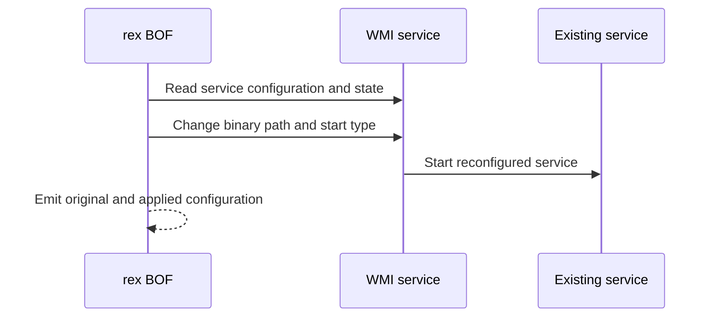

# WMIService

## Mechanism and prerequisites

Uses WMI `Win32_Service` methods to snapshot and reconfigure an existing stopped service so it launches an already-staged service executable. It requires local-administrator rights, reachable WMI/DCOM, an explicitly selected service, and readable original configuration. Preflight captures the original binary path and start type and proves the service is stopped before modification.

Payload support: a Windows service executable that already exists on the target and implements the lifecycle expected by the selected service.

## Privilege and network surface

- Local administrator on the target
- WMI/DCOM via TCP 135 and negotiated dynamic RPC ports
- No BOF-managed SMB delivery; the service executable must already exist remotely

## Operator recovery

Stop the service if safe, compare its current configuration with the emitted recovery context, and restore the original binary path and start type. The preflight-proven original state is stopped. Remove the separately delivered executable only after the service releases it. See [operator recovery](../recovery.md).

## Detection considerations

WMI administration, service configuration changes, unusual image paths, and service starts are well-signatured. Selecting a service that is already noisy can change baseline rarity, but does not remove host telemetry.

