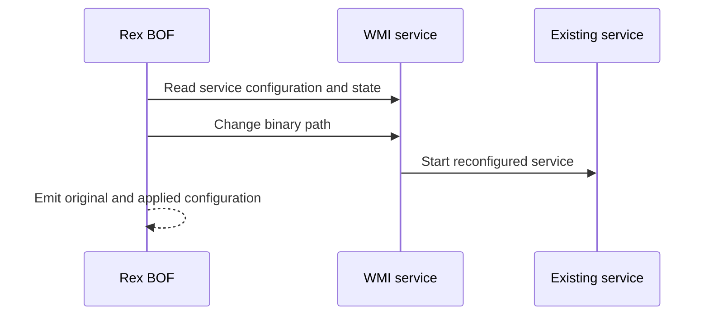

# wmi-service

## How it works

Rex uses WMI `Win32_Service` methods to read and reconfigure an existing
stopped service. Preflight records its binary path and start type and confirms
that it is stopped. Execution changes `PathName`, preserves the service account
and start mode, and requests a start.

The replacement executable must already be on the target and implement the
Windows service lifecycle.

## Service executable contract

The replacement must be a Windows service executable, not an ordinary console
program. It must connect to SCM, implement `ServiceMain`, report service-state
transitions, and run under the existing service identity. Its architecture
must be supported by the target but does not need to match the BOF.

See the complete [Windows service executable contract](../contracts/service-executable.md)
for lifecycle, identity, path, validation, and result requirements.

## Identity

The current or make-token identity authenticates the WMI operations. Starting
the service does not change its configured account; the replacement executable
runs as that existing service identity. See the
[identity matrix](../identity.md).

## Requirements

- Local administrator on the target
- WMI/DCOM via TCP 135 and negotiated dynamic RPC ports
- Contract-compliant service executable already present on the target

## Cleanup

Stop the service, confirm its current configuration, and restore the recorded
binary path and start type. Delete the executable after the service releases
it. See [recovery](../recovery.md).

## Detection

Relevant telemetry includes WMI administration, service configuration changes,
image paths, and service starts.

