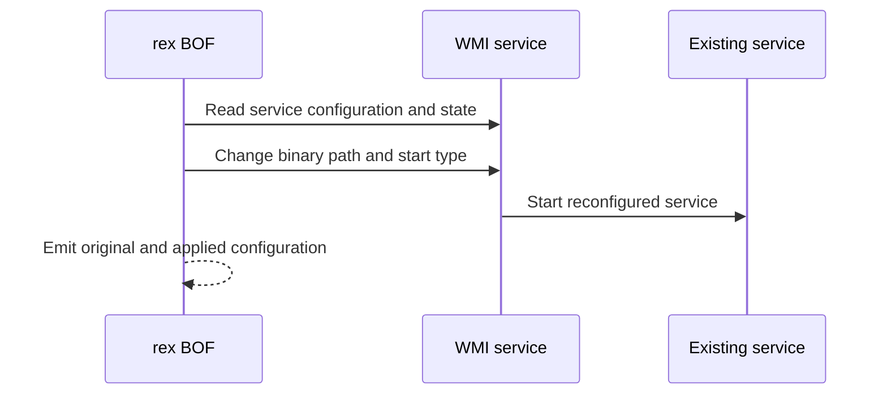

# wmi-service

## How it works

Rex uses WMI `Win32_Service` methods to read and reconfigure an existing stopped
service. Preflight records its binary path and start type and confirms that it
is stopped.

The replacement executable must already be on the target and implement the
Windows service lifecycle.

## Requirements

- Local administrator on the target
- WMI/DCOM via TCP 135 and negotiated dynamic RPC ports
- Service executable already present on the target

## Cleanup

Stop the service, confirm its current configuration, and restore the recorded
binary path and start type. Delete the executable after the service releases
it. See [recovery](../recovery.md).

## Detection

Relevant telemetry includes WMI administration, service configuration changes,
image paths, and service starts.

