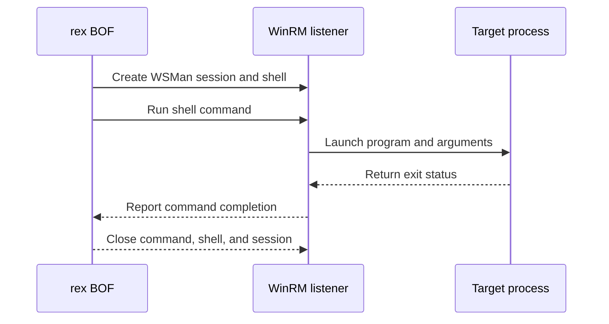

# WSManExec

## Mechanism and prerequisites

Creates a WSMan session and shell, executes a command with `WSManRunShellCommand`, waits for its exit status, and releases the command, shell, session, and WSMan API handles. It accepts a program with optional arguments or a CNA-resolved [launcher contract](../launchers/index.md). It requires local-administrator rights accepted by WinRM policy and a reachable listener.

HTTP on TCP 5985 is the default. `--transport https` selects HTTPS on TCP 5986; `http:<port>` and `https:<port>` select an explicit listener. The BOF does not modify WinRM configuration.

## Privilege and network surface

- Local administrator accepted by the target's WinRM policy
- WinRM HTTP on TCP 5985 by default, or the configured HTTP/HTTPS port
- No BOF-managed SMB delivery; referenced files must already exist remotely

## Operator recovery

The technique closes its process-local WSMan resources and creates no generic persistent remote configuration. Remove separately delivered files only after the command releases them. Command-defined side effects remain operator-owned. See [operator recovery](../recovery.md).

## Detection considerations

WinRM operational logs, shell creation, command lines, and process telemetry are mature detection surfaces. A direct command avoids launcher-specific module-load signals but remains observable.

