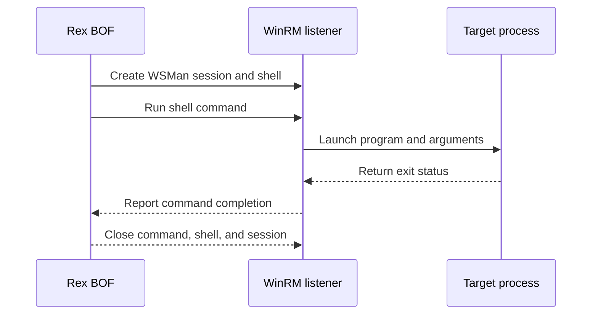

# wsman-exec

## How it works

Rex creates a WSMan session and shell, runs a program, waits for its exit
status, and closes the command and session. Cobalt Strike can supply the program
through a [launcher contract](../launchers/index.md).

HTTP on TCP 5985 is the default. `--transport https` selects HTTPS on TCP 5986;
`http:<port>` and `https:<port>` select an explicit listener. Rex does not
change WinRM configuration.

## Requirements

- Local administrator accepted by the target's WinRM policy
- WinRM HTTP on TCP 5985 by default, or the configured HTTP/HTTPS port
- Referenced files already present on the target

## Cleanup

Delete payload files after the command releases them, and clean up changes made
by the command. See [recovery](../recovery.md).

## Detection

Relevant telemetry includes WinRM logs, shell creation, command lines, and
process creation.

